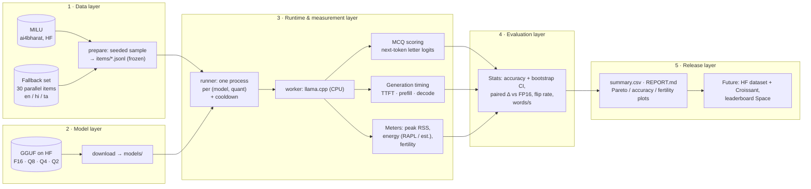

# IndicEdgeBench: Problem, Objectives, Design and Plan

*Evaluation 1 design document. The full motivation is in [proposal.md](proposal.md) and related work in [literature_survey.md](literature_survey.md).*

## 1. Problem statement

Developers who want to run AI **offline on the devices most Indians own**, in Hindi, Tamil, Telugu, Bengali and other languages, must use small (≤ 8B) models compressed by quantization and executed on CPU runtimes. **Nobody has systematically measured how much Indic-language quality is lost under compression, against how much speed, memory and energy is gained.** Indic benchmarks ignore efficiency; on-device benchmarks ignore Indic languages.

## 2. Objectives

1. Build an **open, reproducible harness** that evaluates GGUF-quantized small LLMs on Indic MCQ tasks *and* measures CPU efficiency in the same run.
2. Quantify the **per-language quality drop** at each quantization level (FP16 → Q8 → Q4 → Q2), with confidence intervals and flip rates.
3. Quantify the **efficiency gain** at each level: prefill and decode speed, time-to-first-token, peak RAM, and energy per item and per token.
4. Expose **tokenizer fertility** as a latency multiplier and report user-facing **words/s**.
5. Publish the **quality-vs-efficiency Pareto frontier** per language and model, plus the dataset and code (Hugging Face + GitHub).

## 3. Scope

| | Evaluation 1 (pilot) | Final |
|---|---|---|
| Languages | Hindi, Tamil, English (control) | 4–6 Indic + English |
| Models | Qwen2.5-0.5B (Mac demo); Qwen2.5-1.5B and Llama-3.2-1B (laptop pilot) | 6–8 small models incl. Indic-tuned |
| Quantization | F16, Q8_0, Q4_K_M, Q2_K (GGUF) | + ONNX INT8 |
| Tasks | Knowledge MCQ (MILU, fallback set) | + retrieval, open-ended (judge-validated), fresh contamination-resistant slice |
| Hardware | Apple M3 8 GB (dev), Intel i5-12th-gen-H 16 GB, Windows 11 (main) | + an Android phone |

## 4. System architecture

### Code map

| Module | Responsibility |
|---|---|
| `indicedgebench/config.py` | YAML config → validated dataclasses; one file describes a sweep |
| `indicedgebench/data.py` | MILU loader (gated, auto-approved), bundled fallback, deterministic sampling, `.env` / HF token |
| `indicedgebench/prompts.py` | Zero/few-shot MCQ prompt ending in `Answer:`; generation prompt |
| `indicedgebench/models.py` | GGUF file layout and Hugging Face download |
| `indicedgebench/runner.py` | Freezes items, runs every config in a fresh subprocess, resumes after interruption |
| `indicedgebench/worker.py` | llama.cpp engine; MCQ scoring, generation timing, fertility |
| `indicedgebench/meters.py` | Peak-memory sampler; energy via RAPL (Linux) or CPU-time × TDP estimate |
| `indicedgebench/metrics.py` | Bootstrap CI, paired bootstrap Δ, flip rate |
| `indicedgebench/report.py` | `summary.csv`, `REPORT.md`, plots |

## 5. Methodology

**Quality (MCQ).** The prompt lists the question and options A–D and ends with `Answer:`. The predicted answer is the letter with the highest next-token logit; both `" A"` and `"A"` token variants are considered. This is the log-likelihood protocol of lm-evaluation-harness. It is deterministic and needs no answer parsing, which matters for small models that often fail to follow output formats in Indian languages. Prompts that exceed the context window are counted as wrong and reported separately.

**Statistics.**
- 95% percentile bootstrap CIs over items (1,000 resamples, fixed seed).
- Quantization effect: a **paired** bootstrap of Δaccuracy versus the FP16 baseline on the same items, so item difficulty cancels out.
- **Flip rate:** the share of answers changed versus FP16.

**Efficiency.** Each (model, quant) runs in a fresh process, so memory is attributable to that config.
- Weights are paged in with a warm-up before any timing.
- **TTFT and prefill tokens/s:** from the generation prompts.
- **Decode tokens/s:** greedy decoding of a fixed 64 tokens (EOS ignored, as in `llama-bench`), with 1 warm-up and 3 timed repeats on N prompts per language. The median and standard deviation are reported.
- **Peak RSS:** sampled every 20 ms, plus the OS peak working set on Windows.
- **Thermal control:** a configurable cooldown between configs; thread count is fixed per run.
- **Energy:** Intel RAPL package counters where readable (Linux). Elsewhere it is *estimated* as CPU-seconds × TDP ÷ cores. The method is always labelled next to the number.

**Fertility.** Tokens per whitespace word over each language's items, per tokenizer. Reported with **words/s = decode tokens/s ÷ fertility**, the speed a user actually experiences.

**Reproducibility.**
- Pinned versions (llama-cpp-python 0.3.19), seeds, and a config snapshot in each run directory.
- A frozen item list and a hardware fingerprint (`run_info.json`).
- Per-item raw predictions are committed, so every number can be recomputed with `python -m indicedgebench report`.

## 6. Data

- **MILU** (CC-BY-4.0): 11 languages, test and validation splits. It is gated, but approval is automatic. A free HF token enables it; without one, the harness uses the fallback set.
- **Fallback / pilot set** (`data/fallback/`): 30 hand-authored **parallel** MCQs in English, Hindi and Tamil across science, maths, geography, civics, culture, agriculture and reasoning. Correct answers are balanced across A–D. Because the items are parallel, the same question can be compared across languages. *These items still need native-speaker validation (planned for Month 3).*

## 7. Timeline

| Phase | Weeks | Deliverable | Status |
|---|---|---|---|
| Literature lock-in, problem definition | 1–2 | Survey, gap table | ✅ Eval 1 |
| Harness v0.1: data, runner, metrics, meters, report | 2–4 | This repo | ✅ Eval 1 |
| Pilot: 1 model × 4 quants × 3 languages (Mac) | 4 | `results/smoke_mac` | ✅ Eval 1 |
| Pilot: 2 models × 3–4 quants on Windows laptop + MILU | 5–6 | `results/pilot` | ⏳ next |
| Annotation protocol, native-speaker validation, fresh contamination-resistant slice | 7–10 | Validated set, IAA ≥ 0.6 | planned |
| Full sweep: 6–8 models, 4–6 languages, ONNX INT8, phone | 11–18 | Main results | planned |
| Analysis, Pareto frontiers, leaderboard Space, paper | 19–24 | Paper draft, HF release | planned |

## 8. Risks and mitigations

| Risk | Mitigation |
|---|---|
| Measurement noise / thermal throttling | Fresh process per config, warm-up, repeats with std, cooldowns, fixed threads |
| No energy counters on Windows/macOS | Clearly labelled estimate; RAPL on Linux; battery-drain protocol for phones later |
| Hybrid Intel P/E cores distort speed | Thread-count ablation (physical cores vs. P-cores only) |
| Scope creep | Fixed language/model sets per phase; config-driven sweeps |
| Small pilot sample (30 items) has wide CIs | CIs always shown; MILU with 200+ items per language for the real pilot |
| Being scooped (concurrent 2026 preprints) | Release v0.1 harness + data early on GitHub/HF |
