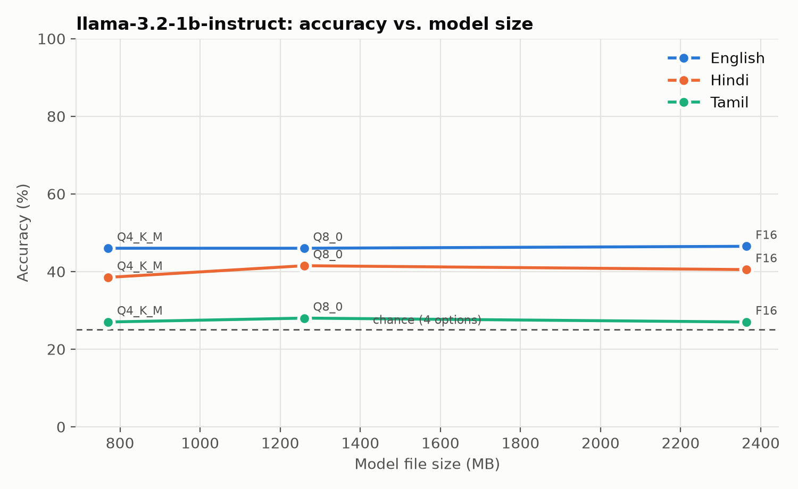
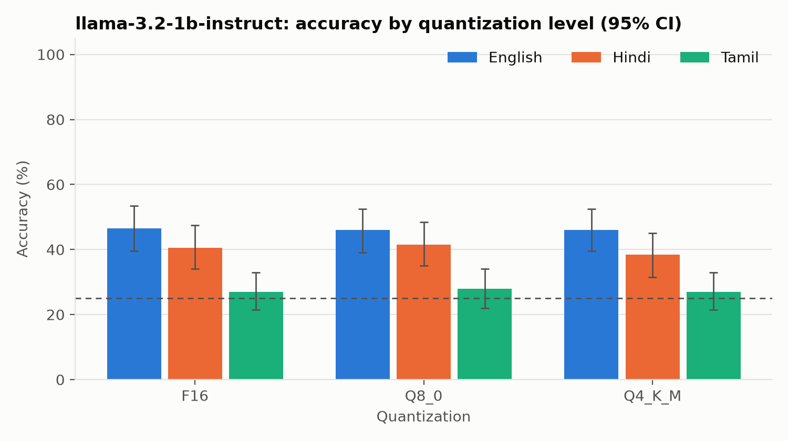

# IndicEdgeBench results: `pilot`

- Data source: **milu**
- Hardware: 12th Gen Intel(R) Core(TM) i5-12500H, 12 cores, 15.7 GB RAM, Windows 11
- llama-cpp-python 0.3.19, Python 3.12.10
- Energy method: estimated (see indicedgebench/meters.py)

Accuracy CIs are 95% percentile bootstrap; `delta_vs_base` is a paired difference vs. the model's baseline quant; `flip_rate` is the share of items whose answer changed vs. baseline.

| model | quant | lang | n | accuracy | acc_ci_lo | acc_ci_hi | delta_vs_base | flip_rate | decode_tps | decode_words_per_s | prefill_tps | ttft_ms | peak_rss_mb | model_file_mb | mcq_j_per_item | tokens_per_word |
|---|---|---|---|---|---|---|---|---|---|---|---|---|---|---|---|---|
| llama-3.2-1b-instruct | F16 | en | 200 | 0.465 | 0.395 | 0.535 |  |  | 20 | 14 | 82 | 790 | 2635 | 2365 | 45 | 1.417 |
| llama-3.2-1b-instruct | F16 | hi | 200 | 0.405 | 0.340 | 0.475 |  |  | 20 | 7.227 | 81 | 1024 | 2635 | 2365 | 67 | 2.783 |
| llama-3.2-1b-instruct | F16 | ta | 200 | 0.270 | 0.215 | 0.330 |  |  | 20 | 2.002 | 83 | 2267 | 2635 | 2365 | 138 | 10 |
| llama-3.2-1b-instruct | Q8_0 | en | 200 | 0.460 | 0.390 | 0.525 | -0.005 | 0.040 | 34 | 24 | 91 | 737 | 1530 | 1260 | 41 | 1.417 |
| llama-3.2-1b-instruct | Q8_0 | hi | 200 | 0.415 | 0.350 | 0.485 | 0.010 | 0.040 | 34 | 12 | 93 | 878 | 1530 | 1260 | 62 | 2.783 |
| llama-3.2-1b-instruct | Q8_0 | ta | 200 | 0.280 | 0.220 | 0.340 | 0.010 | 0.025 | 35 | 3.446 | 94 | 2027 | 1530 | 1260 | 124 | 10 |
| llama-3.2-1b-instruct | Q4_K_M | en | 200 | 0.460 | 0.395 | 0.525 | -0.005 | 0.140 | 47 | 33 | 178 | 371 | 1498 | 770 | 23 | 1.417 |
| llama-3.2-1b-instruct | Q4_K_M | hi | 200 | 0.385 | 0.315 | 0.450 | -0.020 | 0.185 | 48 | 17 | 182 | 450 | 1498 | 770 | 37 | 2.783 |
| llama-3.2-1b-instruct | Q4_K_M | ta | 200 | 0.270 | 0.215 | 0.330 | 0.000 | 0.215 | 45 | 4.423 | 188 | 958 | 1498 | 770 | 73 | 10 |
| qwen2.5-1.5b-instruct | F16 | en | 200 | 0.515 | 0.445 | 0.580 |  |  | 16 | 11 | 57 | 1232 | 3172 | 2950 | 65 | 1.455 |
| qwen2.5-1.5b-instruct | F16 | hi | 200 | 0.325 | 0.260 | 0.390 |  |  | 16 | 3.408 | 58 | 1677 | 3172 | 2950 | 135 | 4.752 |
| qwen2.5-1.5b-instruct | F16 | ta | 200 | 0.325 | 0.260 | 0.390 |  |  | 16 | 1.924 | 59 | 2901 | 3172 | 2950 | 162 | 8.421 |
| qwen2.5-1.5b-instruct | Q8_0 | en | 200 | 0.530 | 0.460 | 0.600 | 0.015 | 0.030 | 28 | 19 | 63 | 1116 | 1789 | 1570 | 60 | 1.455 |
| qwen2.5-1.5b-instruct | Q8_0 | hi | 200 | 0.340 | 0.275 | 0.410 | 0.015 | 0.040 | 28 | 5.922 | 64 | 1560 | 1789 | 1570 | 136 | 4.752 |
| qwen2.5-1.5b-instruct | Q8_0 | ta | 200 | 0.330 | 0.260 | 0.395 | 0.005 | 0.075 | 28 | 3.337 | 62 | 2796 | 1789 | 1570 | 159 | 8.421 |
| qwen2.5-1.5b-instruct | Q4_K_M | en | 200 | 0.500 | 0.430 | 0.565 | -0.015 | 0.155 | 38 | 26 | 123 | 574 | 1756 | 940 | 31 | 1.455 |
| qwen2.5-1.5b-instruct | Q4_K_M | hi | 200 | 0.375 | 0.310 | 0.440 | 0.050 | 0.225 | 39 | 8.182 | 127 | 776 | 1756 | 940 | 68 | 4.752 |
| qwen2.5-1.5b-instruct | Q4_K_M | ta | 200 | 0.295 | 0.230 | 0.360 | -0.030 | 0.255 | 39 | 4.600 | 128 | 1353 | 1756 | 940 | 77 | 8.421 |
| qwen2.5-1.5b-instruct | Q2_K | en | 200 | 0.425 | 0.355 | 0.485 | -0.090 | 0.530 | 47 | 32 | 90 | 780 | 869 | 645 | 42 | 1.455 |
| qwen2.5-1.5b-instruct | Q2_K | hi | 200 | 0.310 | 0.245 | 0.375 | -0.015 | 0.690 | 47 | 9.976 | 92 | 1083 | 869 | 645 | 94 | 4.752 |
| qwen2.5-1.5b-instruct | Q2_K | ta | 200 | 0.270 | 0.210 | 0.330 | -0.055 | 0.615 | 48 | 5.648 | 92 | 1889 | 869 | 645 | 109 | 8.421 |

