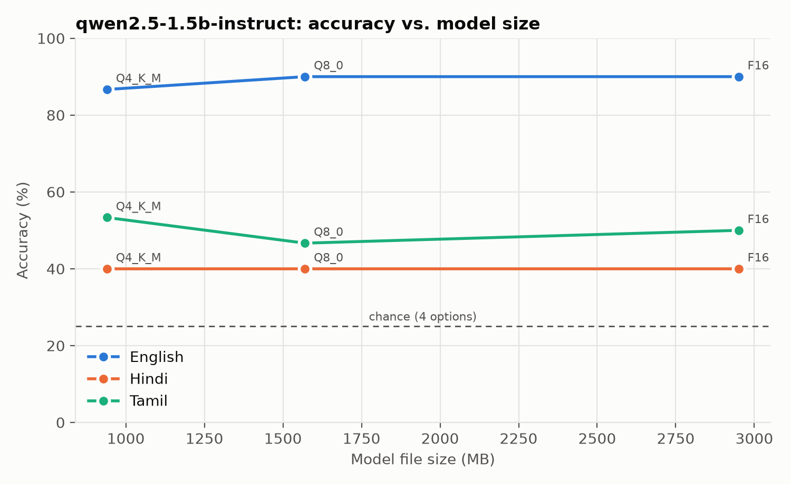
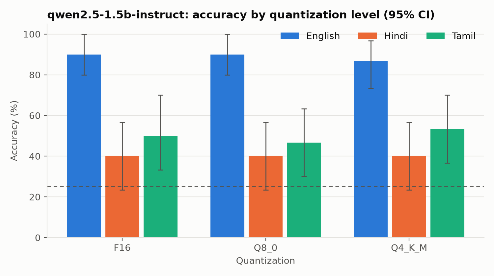
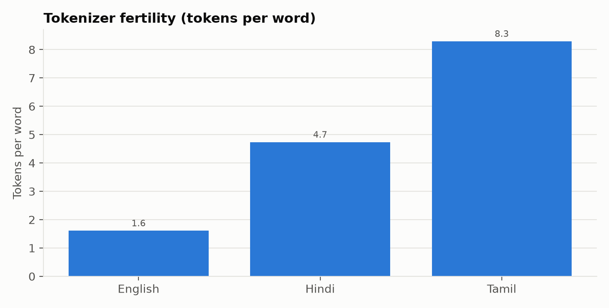
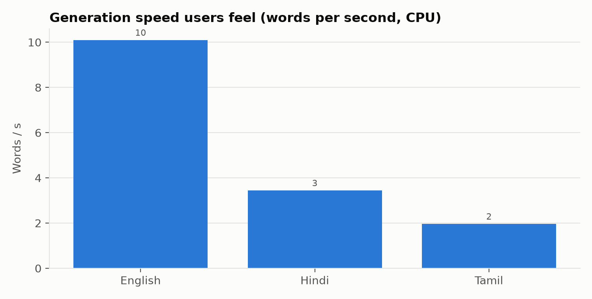

# IndicEdgeBench results: `pilot`

- Data source: **fallback**
- Hardware: 12th Gen Intel(R) Core(TM) i5-12500H, 12 cores, 15.7 GB RAM, Windows 11
- llama-cpp-python 0.3.19, Python 3.12.10
- Energy method: estimated (see indicedgebench/meters.py)

Accuracy CIs are 95% percentile bootstrap; `delta_vs_base` is a paired difference vs. the model's baseline quant; `flip_rate` is the share of items whose answer changed vs. baseline.

| model | quant | lang | n | accuracy | acc_ci_lo | acc_ci_hi | delta_vs_base | flip_rate | decode_tps | decode_words_per_s | prefill_tps | ttft_ms | peak_rss_mb | model_file_mb | mcq_j_per_item | tokens_per_word |
|---|---|---|---|---|---|---|---|---|---|---|---|---|---|---|---|---|
| qwen2.5-1.5b-instruct | F16 | en | 30 | 0.900 | 0.799 | 1.000 |  |  | 16 | 10 | 61 | 757 | 3133 | 2950 | 45 | 1.611 |
| qwen2.5-1.5b-instruct | F16 | hi | 30 | 0.400 | 0.233 | 0.567 |  |  | 16 | 3.445 | 68 | 1153 | 3133 | 2950 | 70 | 4.738 |
| qwen2.5-1.5b-instruct | F16 | ta | 30 | 0.500 | 0.333 | 0.700 |  |  | 16 | 1.965 | 64 | 1637 | 3133 | 2950 | 87 | 8.297 |
| qwen2.5-1.5b-instruct | Q8_0 | en | 30 | 0.900 | 0.799 | 1.000 | 0.000 | 0.000 | 26 | 16 | 61 | 745 | 1751 | 1570 | 44 | 1.611 |
| qwen2.5-1.5b-instruct | Q8_0 | hi | 30 | 0.400 | 0.233 | 0.567 | 0.000 | 0.000 | 28 | 5.964 | 65 | 1199 | 1751 | 1570 | 67 | 4.738 |
| qwen2.5-1.5b-instruct | Q8_0 | ta | 30 | 0.467 | 0.300 | 0.633 | -0.033 | 0.100 | 28 | 3.409 | 64 | 1638 | 1751 | 1570 | 86 | 8.297 |
| qwen2.5-1.5b-instruct | Q4_K_M | en | 30 | 0.867 | 0.733 | 0.967 | -0.033 | 0.067 | 37 | 23 | 116 | 397 | 1718 | 940 | 23 | 1.611 |
| qwen2.5-1.5b-instruct | Q4_K_M | hi | 30 | 0.400 | 0.233 | 0.567 | 0.000 | 0.200 | 33 | 7.021 | 117 | 668 | 1718 | 940 | 36 | 4.738 |
| qwen2.5-1.5b-instruct | Q4_K_M | ta | 30 | 0.533 | 0.367 | 0.701 | 0.033 | 0.167 | 38 | 4.543 | 124 | 853 | 1718 | 940 | 47 | 8.297 |

