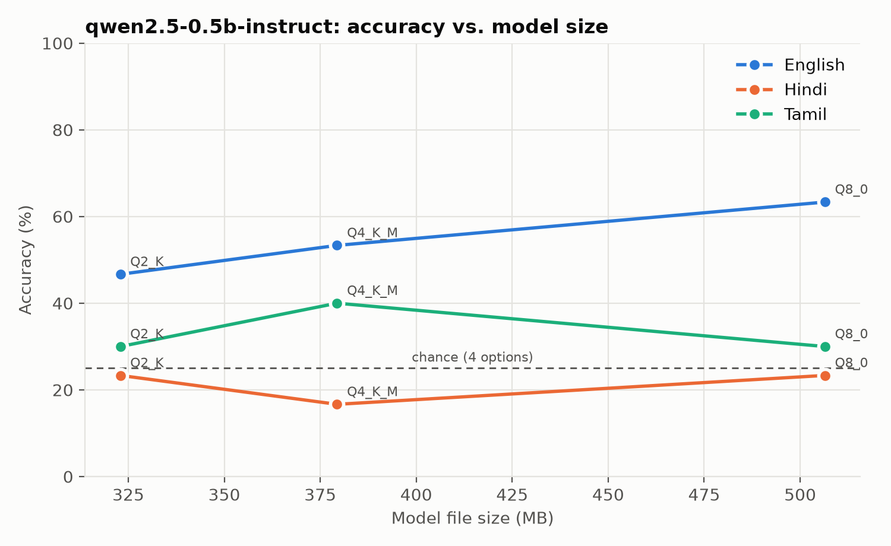
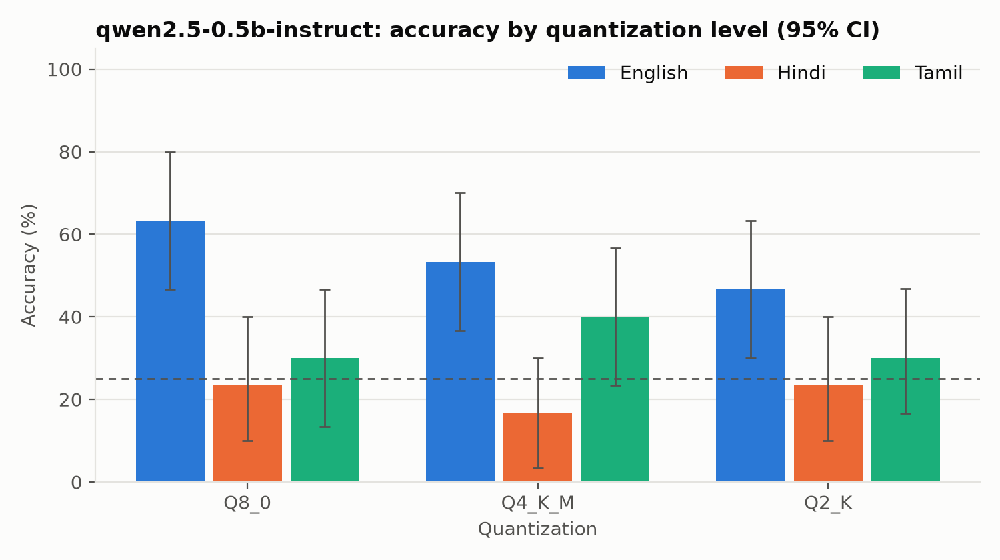
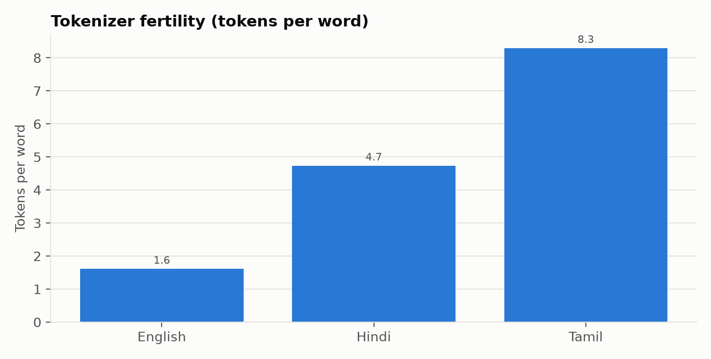
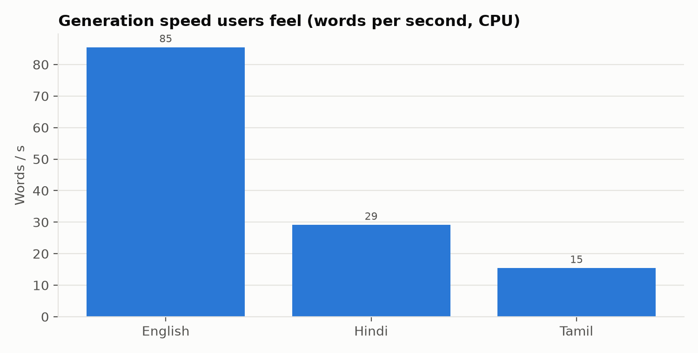

# IndicEdgeBench results: `smoke_mac`

- Data source: **fallback**
- Hardware: Apple M3, 8 cores, 8.0 GB RAM, Darwin 27.0.0
- llama-cpp-python 0.3.19, Python 3.12.8
- Energy method: estimated (see indicedgebench/meters.py)

Accuracy CIs are 95% percentile bootstrap; `delta_vs_base` is a paired difference vs. the model's baseline quant; `flip_rate` is the share of items whose answer changed vs. baseline.

| model | quant | lang | n | accuracy | acc_ci_lo | acc_ci_hi | delta_vs_base | flip_rate | decode_tps | decode_words_per_s | prefill_tps | ttft_ms | peak_rss_mb | model_file_mb | mcq_j_per_item | tokens_per_word |
|---|---|---|---|---|---|---|---|---|---|---|---|---|---|---|---|---|
| qwen2.5-0.5b-instruct | Q8_0 | en | 30 | 0.633 | 0.467 | 0.800 |  |  | 138 | 85 | 836 | 52 | 1135 | 506 | 1.309 | 1.611 |
| qwen2.5-0.5b-instruct | Q8_0 | hi | 30 | 0.233 | 0.100 | 0.400 |  |  | 138 | 29 | 903 | 88 | 1135 | 506 | 2.076 | 4.738 |
| qwen2.5-0.5b-instruct | Q8_0 | ta | 30 | 0.300 | 0.133 | 0.467 |  |  | 128 | 15 | 1009 | 104 | 1135 | 506 | 2.724 | 8.297 |
| qwen2.5-0.5b-instruct | Q4_K_M | en | 30 | 0.533 | 0.367 | 0.700 | -0.100 | 0.200 | 133 | 83 | 411 | 107 | 725 | 379 | 1.210 | 1.611 |
| qwen2.5-0.5b-instruct | Q4_K_M | hi | 30 | 0.167 | 0.033 | 0.300 | -0.067 | 0.667 | 132 | 28 | 617 | 128 | 725 | 379 | 1.725 | 4.738 |
| qwen2.5-0.5b-instruct | Q4_K_M | ta | 30 | 0.400 | 0.233 | 0.567 | 0.100 | 0.733 | 129 | 16 | 571 | 164 | 725 | 379 | 1.970 | 8.297 |
| qwen2.5-0.5b-instruct | Q2_K | en | 30 | 0.467 | 0.300 | 0.633 | -0.167 | 0.167 | 131 | 81 | 544 | 82 | 734 | 323 | 1.248 | 1.611 |
| qwen2.5-0.5b-instruct | Q2_K | hi | 30 | 0.233 | 0.100 | 0.400 | 0.000 | 0.267 | 144 | 30 | 745 | 104 | 734 | 323 | 1.756 | 4.738 |
| qwen2.5-0.5b-instruct | Q2_K | ta | 30 | 0.300 | 0.167 | 0.467 | 0.000 | 0.067 | 138 | 17 | 758 | 144 | 734 | 323 | 2.408 | 8.297 |

